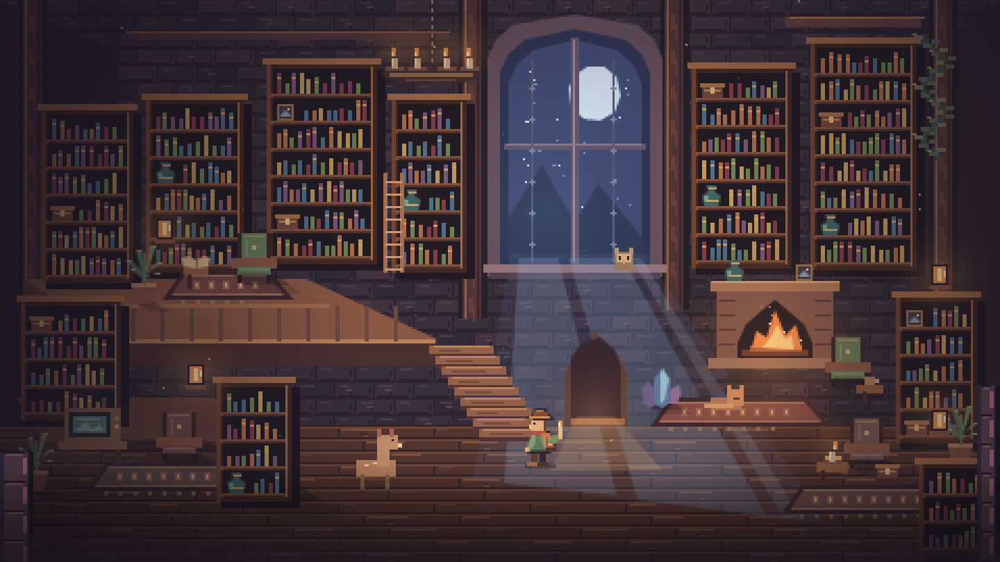

# 用眼睛發力 · Power of Sight

[](https://github.com/libbyhu/power-of-sight/actions/workflows/ci.yml)

> 一間屬於你的魔法書房：書、電影、影集、動漫都可以自在地放在一起。
> *A personal room for everything you've read and watched — no sorting required.*



每位會員有一間私人書房，可以命名、寫介紹，把讀過、看過、想看的作品都放進來。
不必先分類：種類、狀態、關鍵字都只是「篩選」，想看全部的時候，它們就混在一起。
喜好程度（♥）、心得、狀態、完成日期全部選填。

第一次開啟首頁時會播放約 12 秒的開場動畫：小旅人提著燭光爬上紅磚樓梯、推開木門，鏡頭拉遠成為夜晚的古堡圖書交誼廳。場景以程式在 480 × 270 的像素畫布上繪製，沒有使用圖片檔。

## 技術

| 層 | 使用 |
|---|---|
| 前端 | Next.js 16（App Router）、React 19、TypeScript、Tailwind CSS、next-intl（繁中 / English） |
| 後端 | Spring Boot 3.5、Java 21、Spring Security、Spring Data JPA、Flyway |
| 登入 | Email + 密碼（BCrypt），後端簽發 JWT，放在 httpOnly cookie |
| 資料庫 | 本機 H2（免安裝）；正式環境 PostgreSQL（`docker-compose.yml`） |
| 測試 | JUnit 5 + MockMvc 整合測試（17 項） |

```
瀏覽器 ──► Next.js (:3000) ──/api/*──► Spring Boot (:8080) ──► H2 / PostgreSQL
            畫面與雙語          轉址         登入、權限、商業邏輯
```

瀏覽器只跟 Next.js 說話，`/api/*` 由 Next.js 轉給 Spring Boot。前後端在同一個網址下，登入 cookie 不必處理跨網域。

## 在自己電腦上跑起來

需要：**JDK 21**、**Node.js 24 以上**。

**1. 啟動後端**（第一個終端機）

```powershell
cd backend
.\mvnw.cmd spring-boot:run          # macOS / Linux：./mvnw spring-boot:run
```

看到 `Started PowerOfSightApplication` 就好了。資料存在 `backend/.local-data/`。

**2. 啟動前端**（第二個終端機）

```powershell
cd frontend
npm install
npm run dev
```

打開 http://localhost:3000 → 建立書房 → 開始放作品。

**跑後端測試**

```powershell
cd backend
.\mvnw.cmd test
```

**提交前的格式檢查**

```powershell
cd frontend; npm run format; npm run lint
cd ../backend; .\mvnw.cmd spotless:apply
```

命名、commit 訊息與分支規則見 [開發規範](docs/00-開發規範.md)。推送後 GitHub Actions 會自動執行格式檢查、測試與建置。

## 專案結構

```
backend/                 Spring Boot
  src/main/java/com/powerofsight/
    controller/          接收 HTTP 請求、驗證格式
    service/             商業邏輯：權限、交易、版本檢查
    repository/          資料庫存取（JPA）、篩選條件
    entity/              資料表對應的類別
    dto/                 API 的輸入與輸出格式
    security/ config/    JWT、cookie、Spring Security 設定
    exception/           統一錯誤格式
  src/main/resources/db/migration/   Flyway 資料表版本
  src/test/              整合測試
frontend/                Next.js
  app/[locale]/          頁面：首頁、登入、註冊、我的書房、新增、作品、佈置書房、設定
  components/            共用元件
  lib/api/               呼叫後端的函式與型別
  messages/              中英文字
docs/                    設計文件
```

## 設計重點

- **會員只能碰自己的資料**：會員 id 只從驗證過的 JWT 取得，請求裡帶 `ownerId` 會直接被拒絕；查別人的收藏一律回 404，不透露資料存不存在。
- **防止舊畫面覆蓋新資料**：每筆收藏有 `version`，兩個視窗同時修改時，後送出的會收到 409，請使用者重新載入。
- **登入安全**：密碼用 BCrypt；JWT 放在 httpOnly、SameSite=Lax 的 cookie，前端 JavaScript 讀不到；帳號不存在時也跑一次密碼比對，避免從回應時間猜出哪些 Email 註冊過。
- **不強迫分類**：資料表只有一個 `type` 欄位，用來決定「作者／導演」怎麼稱呼，不建立主題頻道。
- **程式繪製的像素場景**：開場動畫與首頁主視覺共用同一個繪圖模組（`frontend/lib/castle`），第一次造訪自動播放，可跳過、可重播，並尊重系統的「減少動態效果」設定。

更多細節：[開發規範](docs/00-開發規範.md) · [架構](docs/01-架構與技術選型.md) · [資料庫](docs/02-資料庫設計.md) · [API](docs/03-API規格.md) · [進度與規劃](docs/04-進度與規劃.md) · [上線路線圖](docs/05-上線路線圖.md)

## 版本沿革

v1–v7 使用 Next.js + Supabase。v8 把後端改寫成 Spring Boot，四個分區（書庫、電影、影集、動漫）合併成一間「我的書房」，介面改為深色的古堡交誼廳風格，首頁加入開場動畫。
